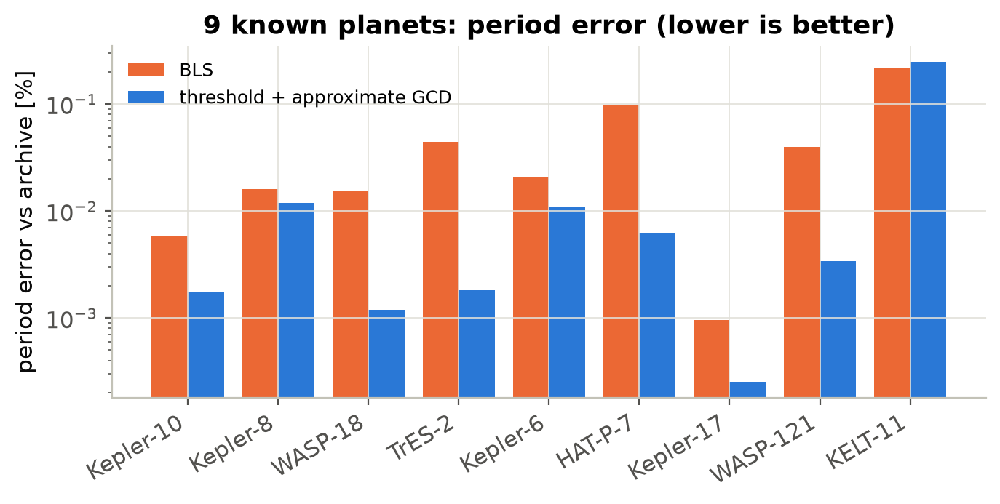
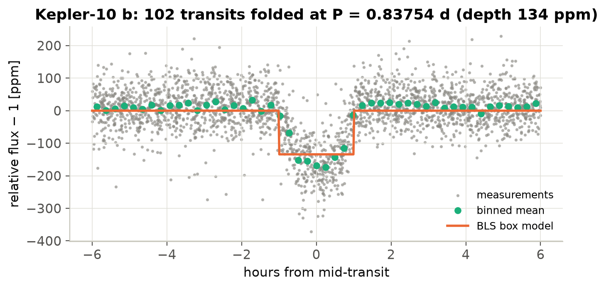
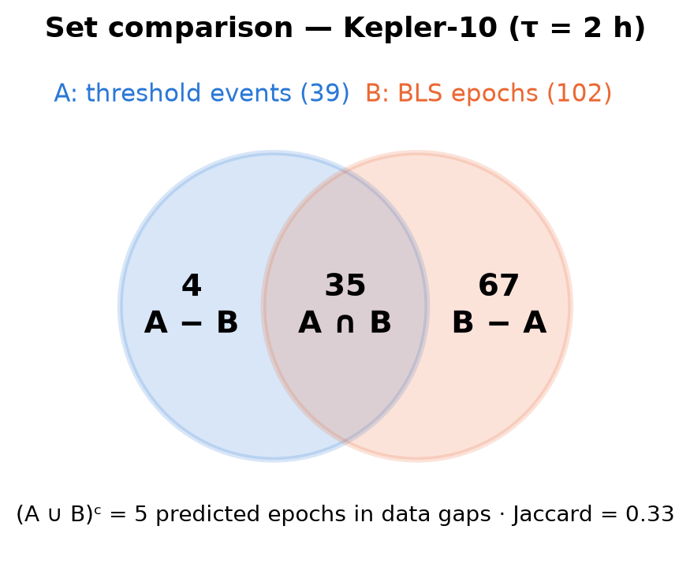
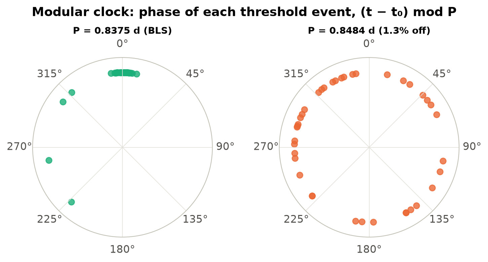
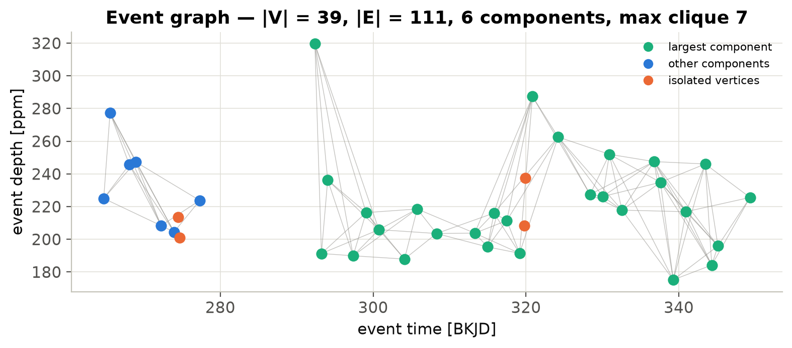
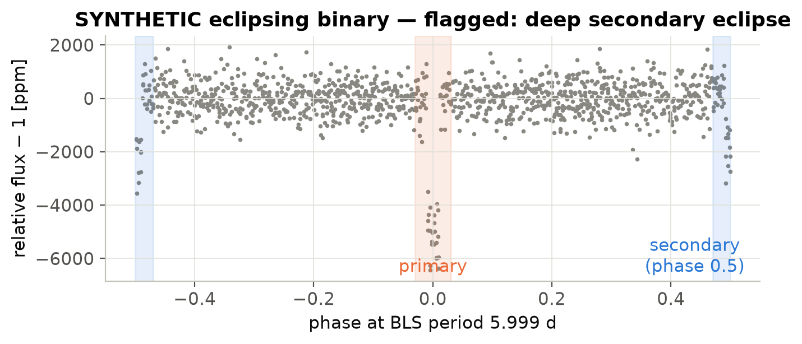
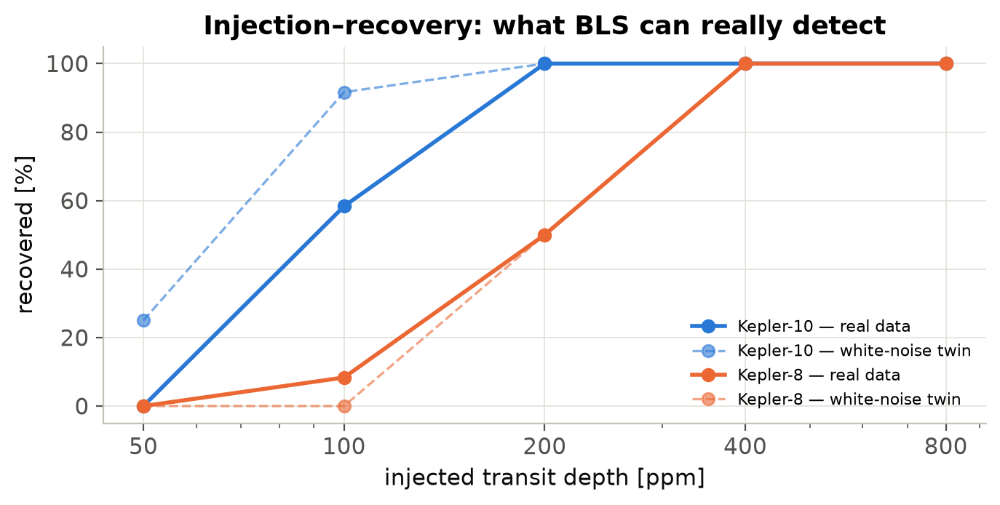

<div class="cover">
<p class="cover-kicker">Discrete Mathematics · Course Project Report</p>
<h1 class="cover-title">ExoScope — Exoplanet Transit Detection and Analysis System</h1>
<p class="cover-sub">Detecting and evaluating transit candidates in real Kepler and TESS light curves,
with Discrete Mathematics inside the pipeline</p>
<div class="cover-group">
<p class="cover-label">Group</p>
<p class="cover-value">L3</p>
<p class="cover-label">Group Members</p>
<ol class="cover-members">
<li>ADI VISHAL</li>
<li>AARAV SHARAN</li>
<li>AARNAV SLESH</li>
<li>AARON DSOUZA</li>
</ol>
</div>
</div>

## Abstract

ExoScope searches real brightness measurements from NASA's Kepler and TESS missions for transits: the small,
periodic dips a planet causes when it crosses its star. Two detectors are compared on the same data: an improved
threshold detector and Box Least Squares (BLS). Five Discrete Mathematics topics are used *inside* the pipeline,
not only to explain it:

- the threshold detector's period is an approximate greatest common divisor (number theory);
- the two methods are compared as sets;
- detected events form a graph of periodic consistency;
- relations and functions describe and validate the pipeline;
- combinatorics sizes and runs systematic experiments.

On nine known planets, BLS recovered every orbital period within 0.22% of the NASA Exoplanet Archive value.
Further tests:

- **Pure noise:** none of 30 light curves was reported as a signal.
- **Simulated eclipsing binaries:** all 30 were flagged as non-planetary.
- **Injection–recovery:** transits injected into real Kepler data show the practical detection limit is about
  100–200 ppm per quarter.

All detections are reported as *candidates*.

## 1. Problem statement and motivation

A transiting planet dims its star by δ ≈ (R_planet / R_star)². That is about 1% for Jupiter crossing the Sun and
84 ppm for Earth. Real light curves also contain photon noise, stellar variability, instrument systematics and
data gaps. On top of that, eclipsing binary stars produce dips that look like planets. The problem is therefore to:

1. find *repeating* dips reliably,
2. compare detection methods fairly, and
3. evaluate a signal without over-claiming.

The original version of the project (v1) used one hard-coded star. It flagged every point below `mean − 3·std`
and took the median spacing of flagged points as the period. On the Kepler-8 data used here, that "period" is
0.0204 d: the cadence (the time between measurements inside one transit), not the 3.52-day orbit.

## 2. Objectives

1. Retrieve and process real Kepler/TESS data reliably, including offline use.
2. Implement and compare an improved threshold detector and BLS.
3. Implement five Discrete Mathematics modules that operate on real analysis output.
4. Evaluate honestly: measured accuracy, false-alarm and false-positive tests, and injection–recovery.
5. Provide an interactive, explainable interface with exports and history.

## 3. Methodology

### 3.1 Data

Light curves are retrieved from MAST through Lightkurve: Kepler long cadence and TESS 2-minute SPOC data, using
the PDCSAP flux. The mission quality flags are kept. A two-level cache stores FITS files plus compact CSV/JSON
copies. Three real light curves are bundled for offline use: Kepler-8 Q2, Kepler-10 Q3 and WASP-18 S2.
Synthetic light curves with injected trapezoidal transits are clearly labelled and provide ground truth.

### 3.2 Preprocessing (`exoscope/processing.py`)

1. Remove NaN cadences and quality-flagged cadences, plus duplicate timestamps.
2. Normalise by the median.
3. Detrend with a Savitzky–Golay filter fitted per data segment, with iterative 3σ masking so transits don't bias
   the trend.
4. Clip only upward outliers at 4σ; downward clipping would remove transits.
5. Optionally bin, e.g. 2-minute TESS data to 10 minutes.

### 3.3 Threshold detector (`exoscope/detection/threshold.py`)

1. The noise σ is 1.4826 × the median absolute deviation, which is robust to the transits themselves.
2. Points below median − kσ (k = 3) are flagged.
3. Consecutive flagged cadences are grouped into events, allowing one unflagged point inside an event.
4. Runs shorter than 2 points are rejected.
5. Each event gets a deficit-weighted centre, a depth, a duration and an SNR.

### 3.4 Box Least Squares (`exoscope/detection/bls.py`)

Astropy `BoxLeastSquares` runs on a uniform frequency grid with Δf = D_min / T², capped at 30,000 periods, using
trial durations of 1–6 h. Per-point errors are scaled up to the measured robust scatter when the archive's errors
are smaller (Section 6.3). The best signal is expanded into its predicted epochs. Epochs with data form the BLS
event set; epochs in gaps are recorded separately. Optional iterative masking searches for up to three signals.

### 3.5 Discrete Mathematics (`exoscope/dmath/`)

| Topic | Implementation | Role in the pipeline |
|---|---|---|
| Number theory | Approximate divisibility \|Δ − nP\| ≤ ε; congruence classes mod P; candidates Δᵢⱼ/k; score = members × fill fraction; least-squares ephemeris tₙ = t₀ + nP; Euclid; rational approximation for aliases | **Produces the threshold detector's period**; tests intervals in the checklist; detects P/2 and 2P aliases |
| Set theory | One-to-one matching within τ (Hungarian algorithm); U = A ∪ B ∪ G; union, intersection, differences, complement, Jaccard; precision/recall as \|D ∩ T\|, \|D − T\|, \|T − D\| | Compares detectors; agreement criterion; synthetic evaluation |
| Graph theory | V = events, {u,v} ∈ E ⇔ ∃ n ≤ N: \|\|Δt\| − nP\| ≤ ε; components, cliques, adjacency matrix, transitivity counterexample | Shows which events support one periodic signal; isolated vertices flag noise |
| Relations & functions | Function, injective, surjective and bijective checks; relationship types; reflexive, symmetric and transitive properties; composition | Time → flux must be a function (duplicates removed); event → epoch non-injective flags split detections; event ↔ algorithm is many-to-many |
| Combinatorics | Cartesian product, rule of product, constraints, projections, C(n, k) selection | Sizes experiments; memoises preprocessing/BLS by projection |

### 3.6 Candidate evaluation (`exoscope/evaluation.py`)

There are ten documented checks:

- repeated events (≥ 3);
- intervals that are integer multiples of P;
- BLS SNR (≥ 10 pass, 7.1–10 marginal);
- odd/even core depths (< 3σ, errors from epoch-to-epoch scatter);
- box model preferred over a sinusoid;
- no deep secondary eclipse at phase 0.5;
- data completeness and transit coverage;
- algorithm agreement (Jaccard);
- depth < 3%;
- duration consistent with the period.

The verdict is gated: an SNR below 7.1 means "no significant signal", and any failed false-positive test means
"signs of a non-planetary origin". The pass count is a teaching aid, not a probability.

## 4. Implementation and architecture

```
MAST / bundled / synthetic → LightCurveData → preprocess ─┬→ threshold ┐
                                                          └→ BLS ──────┤
  ┌────────────────────────────────────────────────────────────────────┘
  ├→ sets → checklist → UI · SQLite · reports
  └→ number theory · graphs · relations · combinatorics
```

- **Language and libraries:** Python 3.13, using Lightkurve, Astropy, NumPy, SciPy, pandas, NetworkX, Plotly and
  Streamlit, with SQLite for history.
- **Logic** (`exoscope/`) contains no UI code and is unit-tested.
- **UI** (`views/`, 13 pages) includes:
  - Home, Explore Targets, Analyze (with Experiment mode), and Candidate Results;
  - five Discrete Mathematics Lab pages, each with concept → worked example → your data → what we learned;
  - Learning Center, Analysis History, and About/Methodology.
- **Exports:** events and candidates as CSV, settings and metadata as JSON, and a Markdown or HTML report.

## 5. Results

All numbers are produced by `scripts/evaluate.py` (`docs/EVALUATION.md`, raw tables in `docs/results/`).

### 5.1 Real data: nine known planets



- **BLS:** recovered all nine periods, with errors from 0.001% (Kepler-17 b) to 0.22% (KELT-11 b).
- **Threshold + approximate GCD:** within 0.25% for all nine, and more precise than BLS on most deep transits,
  because the epochs are fitted by least squares while BLS uses a finite grid.
- **v1:** recovered none.
- **Verdicts:** all nine are rated "strong potential candidate". These planets are confirmed in the archive by
  independent observations; ExoScope only shows that it recovers them.

### 5.2 Kepler-10 b: a small planet

| Quantity | Value |
|---|---|
| BLS period | 0.83754 d (archive 0.83749 d) |
| BLS depth | 134 ppm |
| BLS SNR | 43.5 |
| Implied radius | ≈ 1.3 R⊕ (archive 1.47 R⊕; the box model underestimates depth) |

The threshold detector found 39 events and BLS found 102 epochs. As sets: |A ∩ B| = 35, |A − B| = 4,
|B − A| = 67, five epochs fell in gaps, and the Jaccard index is 0.33. With the threshold events as vertices
(P from BLS, ε = 2 h, N = 10), the graph has 39 vertices, 111 edges, 6 components and 4 isolated vertices, and
its largest clique has 7 vertices.






### 5.3 Synthetic benchmark

The benchmark has 120 seeded light curves (4 depths × 2 noise levels × 3 periods × 5 seeds). Each is a 27-day,
30-minute-cadence light curve with variability, a gap, outliers and missing values. Period recovery within 1%:
v1 2%, improved threshold 47%, BLS 74%. When depth/noise ≥ 3, BLS reaches F1 = 1.00 in every group. Its failures
are at depth ≤ noise per point. The median runtime is 0.2 ms for the threshold detector and 0.17 s for BLS.

### 5.4 False alarms and false positives

On 30 pure-noise light curves, 0 were reported as a significant signal. On 30 simulated eclipsing binaries
(alternating 8000/4000 ppm eclipses), all 30 were flagged as non-planetary by the secondary-eclipse or odd/even
checks.



### 5.5 Injection–recovery on real light curves

Simulated 3-hour transits were injected into Kepler-10 and Kepler-8 data after masking each star's own planet:
depths of 50–800 ppm, 3 periods and 4 phases each. The same injections were made into white-noise twins with
the same scatter.

- **Kepler-10:** recovers 58% at 100 ppm in real data vs 92% in white noise, and 100% from 200 ppm.
- **Kepler-8:** noisier at 183 ppm per point, so it reaches 50% at 200 ppm and 100% at 400 ppm.
- **SNR cost of real noise:** a median of 1.07× relative to white noise.



## 6. Testing and challenges

### 6.1 Automated tests

There are 94 tests (`pytest`), and all pass. They cover:

- number theory, including missed and false events, sub-harmonics and edge cases;
- sets, including De Morgan, inclusion–exclusion and tolerance effects;
- graphs, including non-transitivity;
- relations and combinatorics, including memoisation by projection;
- preprocessing: empty input, NaN, quality flags, duplicates, clipping and detrending;
- the detectors: no transit, a single outlier, a known period, eclipsing binaries, multiple signals;
- storage round-trips, reports and history reload;
- a headless render of every page, plus real button flows (analysis form, experiment mode, combinatorics run,
  synthetic generator, quiz, history reload and re-run).

The live MAST search and download were also verified by hand in the browser: Kepler-5 Q2 gave
P = 3.54862 d against the archive's 3.54847 d.

### 6.2 Bugs found by evaluation and fixed

1. **Sub-harmonic period:** one false dip let P/3 win the approximate GCD. Fixed by scoring members × fill
   fraction.
2. **Odd/even test failing real planets:** Astropy's per-point errors made sampling differences look
   significant. Fixed by using errors from the epoch-to-epoch scatter of core depths.
3. **Shape test with the wrong sign:** Astropy's harmonic Δlog L is *sine − box*.
4. **False alarms:** 5 of 10 noise curves were graded "possible signal", because BLS's best of ~10⁵ trials reaches
   SNR 4–6 (the look-elsewhere effect). SNR < 7.1 now means not detected; the result is 0/30.
5. **Optimistic SNR on real data:** injection–recovery showed the archive's per-point errors are 1.3–1.9×
   smaller than the measured scatter. BLS now scales them up; Kepler-10's SNR went from 67 to 43.5.

## 7. Limitations

- The app finds candidates only. There is no pixel-level, spectroscopic or radial-velocity vetting.
- The box model ignores limb darkening, so depths and radii are approximate.
- Each analysis covers one quarter or sector, so planets with fewer than three transits in it cannot be shown to
  be periodic.
- The checklist thresholds are conventions, not calibrated probabilities.
- The synthetic benchmark uses white noise. The real-data validation covers nine mostly deep, known planets plus
  one small one. The injection test uses two host stars.
- Searching MAST for new targets needs a network connection, and the first download takes up to about a minute.

## 8. Relation to the literature

The course reading (*Finding Exoplanets with the Transit Method*) was used as follows:

- **Lightkurve** is used for data access.
- **Collier Cameron et al. (2006):** "clean systematics first, then search" is followed (detrending before BLS,
  with a bounded grid). SysRem is not implemented, because it needs many stars per frame.
- **Giacobbe et al. (2012):** the injection-test approach is used to measure detection limits.
- **Rodenbeck et al. (2018):** the lesson that preprocessing can create "discoveries" motivates Experiment mode,
  the Combinatorics explorer and injection–recovery.
- **Future work:** Transit Least Squares (Hippke & Heller 2019), an FFT search for ultra-short periods
  (Sanchis-Ojeda et al. 2014) and CNN vetting (Shallue & Vanderburg 2018) are not implemented.

## 9. Conclusion

ExoScope shows that Discrete Mathematics can be the working machinery of a scientific pipeline:

- congruences and approximate GCDs find periods that survive missed and false dips;
- set operations make detector comparison exact;
- a graph of periodic consistency exposes which dips support one signal;
- relations and combinatorics give the pipeline structure and make experiments countable.

Applied to real NASA data, it recovers known planets to within 0.22% in period, and it measures its own limits
honestly. Every result is reported as a candidate.

## References

1. Collier Cameron, A. et al. (2006). A fast hybrid algorithm for exoplanetary transit searches. MNRAS 373, 799.
2. Giacobbe, P. et al. (2012). Photometric transit search for planets around cool stars from the western Italian
   Alps. MNRAS. arXiv:1206.1729.
3. Sanchis-Ojeda, R. et al. (2014). A study of the shortest-period planets found with Kepler. ApJ 787, 47.
4. Shallue, C. J. & Vanderburg, A. (2018). Identifying exoplanets with deep learning. AJ. arXiv:1712.05044.
5. Rodenbeck, K. et al. (2018). Revisiting the exomoon candidate signal around Kepler-1625b. A&A 617, A49.
6. Hippke, M. & Heller, R. (2019). Transit Least Squares. A&A 623, A39.
7. Lightkurve Collaboration / KeplerGO. lightkurve. doi:10.5281/zenodo.1181928.
8. Kovács, G., Zucker, S. & Mazeh, T. (2002). A box-fitting algorithm in the search for periodic transits.
   A&A 391, 369.
9. NASA Exoplanet Archive, Planetary Systems Composite Parameters (accessed 2026-10-28).
